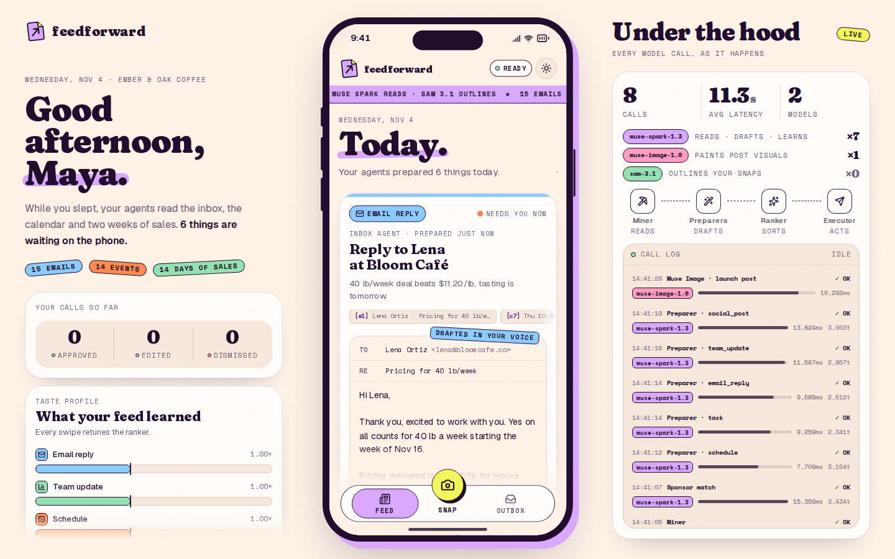
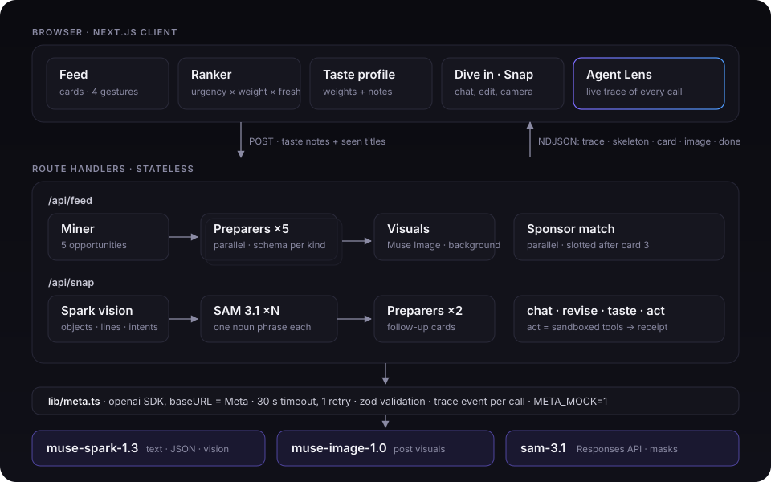
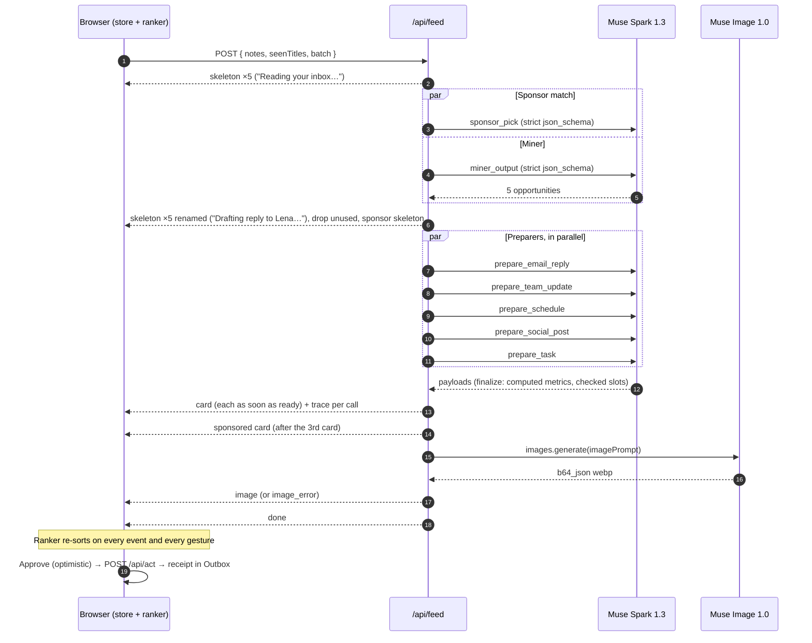
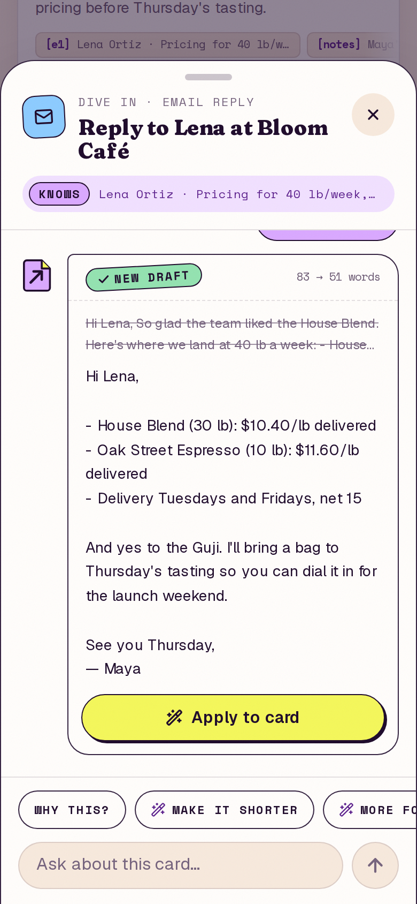
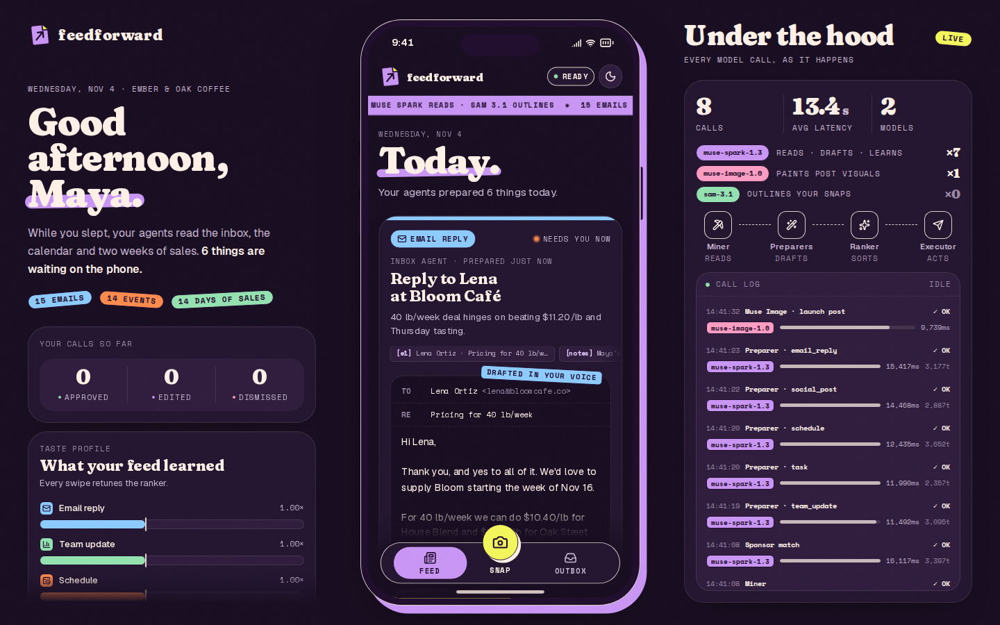
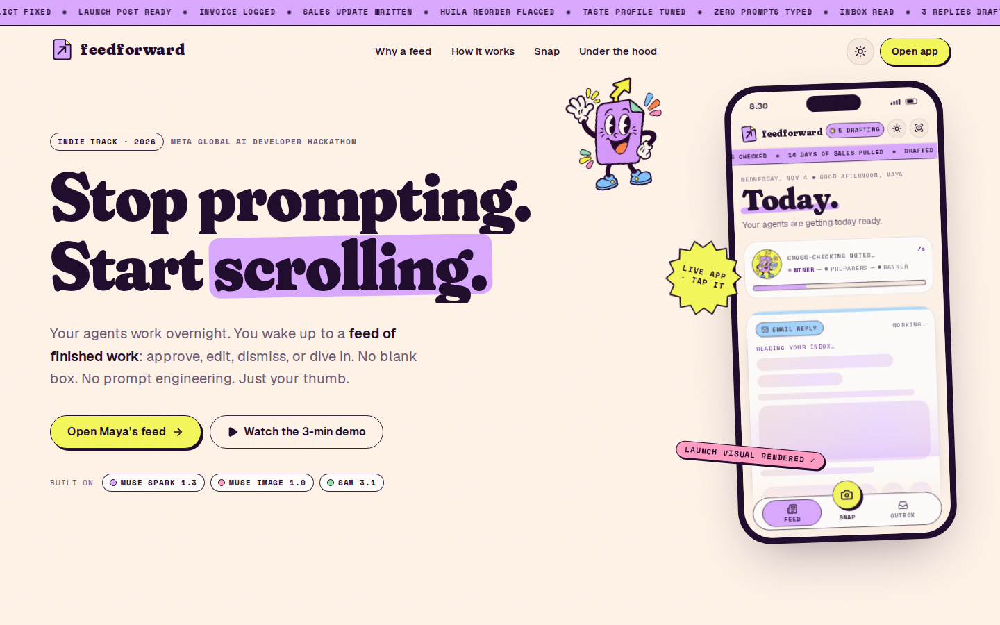
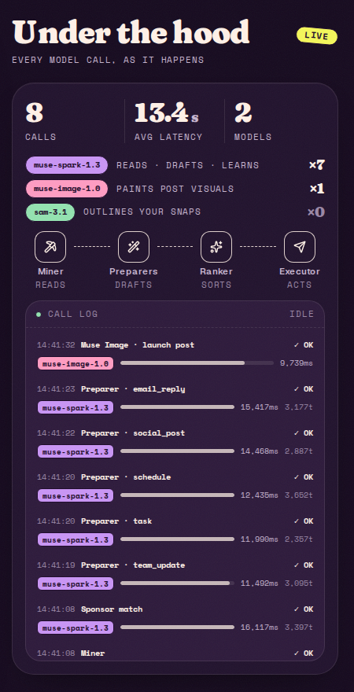
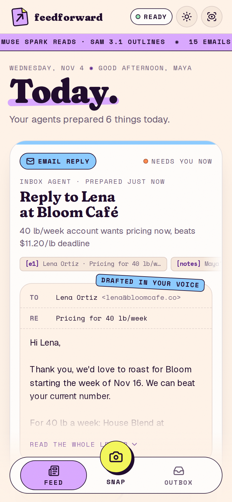
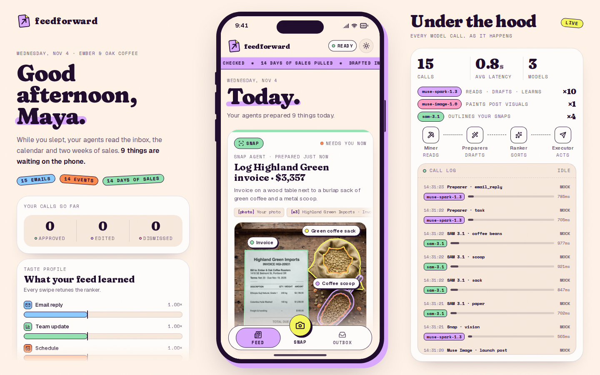

<div align="center">

# Feedforward

### Stop prompting. Start scrolling.

**A feed of work your agents already did.** Agents built on Meta's models read your inbox, calendar, sales and notes, do the work in the background, and hand you each result as a card. You approve, edit, dismiss, or dive in.

[](https://nextjs.org)
[](https://www.typescriptlang.org)
[](#muse-spark-13-the-agent-brain)
[](#muse-image-10-the-visual-language-of-a-feed)
[](#sam-31-the-physical-world-as-cards)
[](#tests)
[](LICENSE)



**[▶ Demo video (3 min)](<!-- VIDEO_URL -->)** · **[Live app (local): `localhost:3100/app`](http://localhost:3100/app)** · **[Landing page: `localhost:3100`](http://localhost:3100)**

<sub>Meta Global AI Developer Hackathon 2026 · Indie track · Problem statement: <i>Build for Your World</i></sub>

</div>

---

## Contents

- [TL;DR](#tldr)
- [The problem, and the insight](#the-problem-and-the-insight)
- [Meet Maya](#meet-maya)
- [What it does](#what-it-does)
- [How Feedforward uses Meta's models](#how-feedforward-uses-metas-models)
- [Architecture](#architecture)
- [Engineering quality](#engineering-quality)
- [Design](#design)
- [Judging criteria, mapped to the code](#judging-criteria-mapped-to-the-code)
- [Getting started](#getting-started)
- [Using the app](#using-the-app)
- [Limitations and honest notes](#limitations-and-honest-notes)
- [What's next](#whats-next)

---

## TL;DR

- **A new form factor for agents.** No prompt box. Agents look at your world, pick the next useful actions, do the work, and line them up in a vertical feed. Your whole job is one gesture per card.
- **Three Meta models in production, each with a precise role.** `muse-spark-1.3` (text and vision, strict `json_schema`, `reasoning_effort: "low"`) runs a multi-agent pipeline; `muse-image-1.0` renders launch-post visuals; `sam-3.1`, through the Responses API with one-bit masks, outlines objects in your photos pixel by pixel.
- **A real pipeline, not a script.** Miner → parallel Preparers → client-side Ranker → sandboxed Executor, streamed to the browser as typed NDJSON events, with skeletons from the first millisecond and an **Agent Lens** that shows every model call live.
- **It learns while you scroll.** Every approve, edit or dismiss moves the ranking instantly, and every 3 gestures Muse Spark rewrites a short taste memory that changes what the Miner looks for in the next batch.
- **It pays for itself, honestly.** One clearly labeled sponsored action per batch, matched to your plans this week (not your clicks), with a *"Why am I seeing this?"* that tells you exactly why. Every sponsor brand is invented.

---

## The problem, and the insight

Every AI product today opens on an empty box and asks: *what do you want?*

That question is a lot of work. Chat asks people for **digital labor**: figure out what the AI can do, explain the task, paste the context, check the result, then do it all again tomorrow. Power users love it. Most people never get past the blank text field, and nobody prompts their way into a complicated multi-step agent workflow.

Meanwhile, three billion people already spend hours a day in an interface that asks nothing of them: **the feed**. They know how to scroll, spot something useful, and tap.

Feedforward is built on one idea: **invert the prompt.** Instead of the user describing work to the agent, the agent describes finished work to the user. The system knows your context, so it should bring you the next useful action, already done, one tap from shipped. You approve, edit, dismiss, or jump into a chat that already knows everything about the card.

That gives you three things chat can't:

1. **Discovery.** People learn what agents can do by seeing what agents did, not by guessing what to ask.
2. **Leverage.** Reviewing a finished draft takes two seconds. Writing the prompt that produces it takes two minutes.
3. **A business model.** A feed can carry ads. Meta invented the feed, and the feed pays for Meta. A feed of useful actions can carry **sponsored actions**, relevant because they match what you're doing this week.

> *Chat asks you for labor. The feed gives you leverage.*

---

## Meet Maya

**Maya Chen** runs *Ember & Oak Coffee Roasters*, a small specialty roastery in Portland, Oregon. It's Wednesday, 8:30 AM. On Friday she launches a new single origin, an Ethiopia Guji Natural. She's trying to close a 40 lb/week wholesale account, she owes an investor her numbers before Thursday's coffee chat, and she has promised herself to answer every customer complaint within 24 hours.

> Maya, her company, her customers, suppliers, investor, team and every sponsor brand are **fictional**. Her sandbox is realistic: **15 emails** (a wholesale lead, an investor, a supplier invoice, a customer complaint, newsletter noise…), **14 calendar events** with real conflicts, **140 rows of sales** over 14 days across web, wholesale and café, and her launch notes. Everything on her cards is generated live from that data.

She opens Feedforward. Nothing to type. Within seconds, five skeleton cards appear with live, typed labels (*"Reading your inbox…"*, *"Pulling 14 days of sales…"*, *"Scanning this week's calendar…"*). Then the Miner reports back, the skeletons are renamed to what it found (*"Drafting reply to Lena…"*, *"Resolving Thursday conflict…"*), and cards land one by one:

| Card | What the agent already did |
|---|---|
| **Reply to Lena at Bloom Café** | Drafted the pricing reply in Maya's voice, with the wholesale terms from her notes, ready to send |
| **Share yesterday's numbers** | Computed revenue by channel against the 7-day average, drew the 14-day sparkline, and wrote the post for `#team` |
| **Fix Thursday's double booking** | Found that an investor coffee chat overlaps a client tasting, picked a free slot that clears her calendar with a 30-minute travel buffer, and wrote the note proposing it |
| **Launch post for Friday** | Wrote the Instagram caption and hashtags, and Muse Image is rendering the product shot in the background |
| **The decision due today** | Broke it into 3–5 concrete steps with names, amounts and dates |
| **Sponsored** | A fictional courier, packaging or service brand that fits her actual week, with the reason in one line |

Scroll to the bottom and the next batch digs deeper: other emails worth answering, follow-ups, patterns in the numbers.

---

## What it does

### Eight card kinds, one schema each

Every card is a typed object (`Card` in [`lib/schemas.ts`](lib/schemas.ts)) whose `payload` is validated by a per-kind zod schema. The same schema is used to constrain the model, to validate its output, to check edits, and to validate the request when the card is approved.

| Kind | Payload (zod) | Approve runs | What's special |
|---|---|---|---|
| `email_reply` | `{ to, subject, body }` | `send_email` | 60–120 words in her voice, answers every question in the source email, her exact signature |
| `team_update` | `{ channel, message, metrics[], series[] }` | `post_message` | **Metrics and sparkline are computed in code** from `sales.json`; the model only writes the words |
| `schedule` | `{ event, conflict, proposed{start,end}, message }` | `create_event` | **Free slots are computed in code** (weekday business hours, 30 min travel buffer); a busy pick by the model is replaced |
| `social_post` | `{ platform, caption, imagePrompt, hashtags[] }` | `publish_post` | The Preparer writes an image prompt; **Muse Image** renders it in the background |
| `task` | `{ steps[] }` | `create_task` | 3–5 ordered steps, each starting with a verb |
| `insight` | `{ headline, detail, stat }` | `create_task` | One sharp pattern from the data and a big number |
| `snap` | `{ summary, width, height, objects[{label, box, svgPath}], lines[] }` | `log_expense` | Built from a photo by **Spark vision + SAM 3.1**, with animated pixel outlines |
| `sponsored` | `{ offer, cta }` + `sponsored{brand, reason}` | `open_offer` | Labeled, explained, dismissible, and it trains the feed like any other card |

### Four gestures

- **Approve** (swipe right, or the yellow button): the card stamps out and the action runs through a sandboxed tool (`TOOL_BY_KIND`). The UI is **optimistic**: the card leaves and a "sending" entry appears in the **Outbox** immediately, then the receipt replaces it. If the call fails, the card goes back to its exact slot, the weight change is rolled back, and a toast says so.
- **Edit**: a bottom sheet with a per-kind payload editor. *Save*, or *Save & approve* in one tap.
- **Dismiss** (swipe left): the card slides away and the feed retunes (*"Tuned: fewer team updates"*).
- **Dive in**: a chat sheet whose system prompt already contains the card, the **full text of its source documents**, and Maya's context. Starter chips: *Why this?*, *Make it shorter*, *More formal*, *What if I say no?*. The two rewrite chips return a **new, schema-valid payload** that you preview and apply to the card in one tap.

Swipes are physical: a 110 px distance or 650 px/s velocity threshold, elastic drag, a stamp that scales with the drag, and spring exits. With `prefers-reduced-motion`, drag is disabled and buttons do the work.

### Snap: the physical world goes in the feed too

Take a photo (camera on mobile, a file on desktop, or one of two demo photos: a supplier invoice and a stock shelf). The client downscales it to ≤1280 px, then:

1. **Muse Spark vision** reads it *against Maya's context*: scene, title, a summary of what matters, the printed line items with a total, 2–4 objects worth outlining, and exactly 2 follow-up intents. On the demo invoice, Spark linked the paper to the supplier's email and to a teammate's low-stock note **without being asked**.
2. **SAM 3.1** outlines each object, one request per noun phrase, all in parallel. The skeleton label follows along (*"SAM 3.1 is outlining 3 objects…"*).
3. The **snap card** lands pinned at the top of the feed, with the photo and **animated SAM outlines** that draw themselves in (`pathLength` 0 → 1).
4. Two **Preparers** turn the follow-up intents into real cards (confirm with the supplier, reorder, log the expense).

### Sponsored actions, with "Why am I seeing this?"

Every batch carries one sponsored card from a catalog of **six invented brands** (`data/sponsors.json`: PickupPilot, Kraftfold, Ledgerleaf, TapStall, Lumen & Lens Studio, Roastwell Service Co.). Muse Spark picks the one that fits her goals, notes and calendar, and writes the reason (*"Launching Guji on Friday → …"*, ≤110 chars). The sponsor id is a **zod enum of the brands not shown yet**, so the decoder itself rules out invented brands and enforces rotation. The card wears a *Sponsored* sticker, and *"Why am I seeing this?"* shows the reason in plain words. It sits at position 4, then every 6th card.

### It learns while you scroll

Two layers of learning, one fast and one smart:

- **Weights (instant, client side, [`lib/taste.ts`](lib/taste.ts)).** Approve `+0.15`, edit `+0.05`, dismiss `−0.25` on that card kind, clamped to `[0.2, 2.5]`. The feed re-ranks immediately with Framer Motion `layout` animations, and a toast names the change.
- **Taste memory (Muse Spark, every 3 gestures, [`lib/agents/taste.ts`](lib/agents/taste.ts)).** The last 30 gestures become at most 5 short notes (*"Skips newsletters and promos"*, *"Approves wholesale replies fast"*). A *Learned* toast shows the new one. The notes are injected into the next Miner prompt, so the next batch is visibly different.

### Agent Lens: under the hood, live

Every model call emits a `trace` event: step (`Miner`, `Preparer · email_reply`, `SAM 3.1 · paper`, `Muse Image · launch post`, `Executor · send_email`…), model, latency, tokens, and status (`ok`, `error`, or `mock`). The **Agent Lens** renders them as a live typed log with a pipeline header (**Miner → Preparers → Ranker → Executor**) that lights up the stage currently running. On desktop it sits next to the phone; on mobile it lives in an *Under the hood* sheet together with the taste profile.

---

## How Feedforward uses Meta's models

Every call goes to the Meta Model API (`https://api.meta.ai/v1`) through **one file**, [`lib/meta.ts`](lib/meta.ts). The API speaks the same wire format as the `openai` npm SDK, so the SDK is used purely as an HTTP client with `baseURL` pointed at Meta. The wrapper adds what an agent pipeline needs: a 30 s timeout, one retry, zod validation of every output, a trace event per call for the Agent Lens, and a mock switch. `lib/meta.ts` imports `server-only`, so the build fails if anything tries to pull it into the browser bundle.

```ts
export const MODELS = {
  spark: "muse-spark-1.3",
  wonder: "muse-wonder-1.0", // benchmarked for chat, not used (see below)
  image: "muse-image-1.0",
  sam: "sam-3.1",
} as const;
```

### Muse Spark 1.3: the agent brain

Spark runs seven distinct roles: **Miner, Preparers, Sponsor matcher, Taste memory, Snap vision, Revise, and Dive-in chat.** Six of them return structured data through one function, `chatJSON`:

```ts
const res = await meta().chat.completions.create({
  model,
  messages: opts.messages,
  reasoning_effort: opts.effort ?? "low",
  response_format: {
    type: "json_schema",
    json_schema: { name: opts.name, strict: true, schema: toStrictJsonSchema(opts.schema) },
  },
});
const value = opts.schema.parse(JSON.parse(stripFences(text)));
```

**Why `reasoning_effort: "low"`.** Spark is a reasoning model, and its latency is driven by hidden reasoning tokens, not prompt size. In our tests, higher settings were about 3× slower for the same structured call, and `low` was enough for drafting and extraction. We also tested the other values: `minimal` is accepted but wasn't faster than `low` in our run, and `none` returns a 400. Every call in the app uses `low`.

**Why strict `json_schema`, generated from zod.** Each agent's contract is a zod schema, and strict mode needs every object closed with every key required. `toStrictJsonSchema` derives the JSON Schema with `z.toJSONSchema` and walks it to enforce exactly that, so the TypeScript type, the model constraint and the runtime validator are **one definition**:

```ts
export function toStrictJsonSchema(schema: z.ZodType): Record<string, unknown> {
  const json = z.toJSONSchema(schema, { target: "draft-7", io: "output" }) as Record<string, unknown>;
  delete json.$schema;
  const walk = (node: unknown) => {
    if (!node || typeof node !== "object") return;
    if (Array.isArray(node)) return node.forEach(walk);
    const obj = node as Record<string, unknown>;
    if (obj.type === "object" && obj.properties) {
      obj.additionalProperties = false;
      obj.required = Object.keys(obj.properties as object);
    }
    Object.values(obj).forEach(walk);
  };
  walk(json);
  return json;
}
```

The schemas do real work beyond shape:
- The **Preparer** schema is built per call: `z.object({ payload: PAYLOAD_SCHEMAS[kind], actionLabel: z.string() })`.
- The **Sponsor** schema's `sponsorId` is `z.enum(<ids of the brands not shown yet>)`, so rotation and "no invented brands" are enforced by the decoder, not by hope.
- The **Miner**'s `kind` is `CardKind.exclude(["snap", "sponsored"])`, so it can only propose work a Preparer knows how to do.
- **Revise** reuses the kind's payload schema, so a "make it shorter" rewrite can never break the card.

**The model writes the words; code owns the facts.** Spark is excellent at drafting and weak at arithmetic and calendar bookkeeping, so the Preparer's `finalize` step overrides what must be exact: `team_update` metrics and sparkline are copied from `salesFacts()` computed from the data, a `schedule` proposal that isn't free is replaced by the first computed free slot (and the button label is reset to match), and hashtags are normalized.

**Vision.** Snap sends the photo as an `image_url` data URL next to the ~16 KB persona context, under a strict `SnapVision` schema. One output detail matters a lot for SAM: each object comes back as a **`phrase`** (a plain visual noun SAM can find: *"paper"*, *"sack"*) and a **`label`** (what it is to Maya: *"Invoice"*, *"Green coffee sack"*). That translation is the fix for a real SAM constraint we found (below).

**Chat.** Dive-in uses `chatStream`, a streamed `/chat/completions` call (Spark, effort low) whose deltas are piped straight to the browser as plain text, with cancellation when the sheet closes.

**Muse Wonder, benchmarked and rejected.** We ran the same Dive-in prompt on `muse-wonder-1.0`: slightly sharper (it caught a Thursday calendar clash Spark missed), but first token after 15–36 s versus 6.6–9.2 s for Spark. For an interactive sheet, Spark wins. Raw numbers in [`docs/BUILD_NOTES.md`](docs/BUILD_NOTES.md).

### Muse Image 1.0: the visual language of a feed

A feed is visual. The `social_post` Preparer writes a detailed photographic prompt (subject, setting, props, natural light, lens, mood; explicitly no text or logos), and the feed route renders it **in the background** while the card is already usable:

```ts
const res = await meta().images.generate({ model: MODELS.image, prompt: opts.prompt, size: "1024x1024" });
const b64 = res.data?.[0]?.b64_json;
if (!b64) throw new Error("Muse Image returned no image");
return { value: `data:image/webp;base64,${b64}` };
```

The response is `b64_json` **webp** (about 1600 px), so it becomes a data URL with no storage or CDN in between. A finished image arrives as an `image` event; a failure arrives as `image_error`, the card stays fully usable, and a retry goes through `/api/image`. In our tests Muse Image also rendered printed text and numbers exactly (an invoice header, line items, and a total that adds up, 3 out of 3 tries).

### SAM 3.1: the physical world as cards

SAM 3.1 is called through the **Responses API**, one noun phrase per request, with one-bit mask encoding:

```ts
const res = await meta().responses.create({
  model: MODELS.sam,
  input: [{
    role: "user",
    content: [
      { type: "input_text", text: opts.phrase },
      { type: "input_image", image_url: opts.imageDataUrl, detail: "auto" },
    ],
  }],
  metadata: { mask_encoding: "one_bit" },
});
return { value: res.output_text ?? "" };
```

The output is a compact special-token string, one record per instance (this is the start of a real recorded response in [`tests/fixtures/sam-paper.txt`](tests/fixtures/sam-paper.txt)):

```
<0f>0<|box;x1=93;y1=271;x2=717;y2=1106;w=1280;h=1280|><|mask;x=0;y=0;data=836,625,!!!!$(Dpu2{cg parses it with [`@meta-sam/parser`](https://www.npmjs.com/package/@meta-sam/parser) and maps each mask into image pixels. Two undocumented details had to be worked out by trial, and both are handled in code:

```ts
// 1. The parser is a stream parser and needs output_text.done before completed,
//    even for a non-streamed response, or it throws ResponsesStreamLaneError.
async function* events(): AsyncIterable<ResponsesEvent> {
  const lane = { item_id: "m", output_index: 0, content_index: 0 };
  yield { type: "response.output_text.delta", ...lane, delta: outputText };
  yield { type: "response.output_text.done", ...lane, text: outputText };
  yield { type: "response.completed" };
}

// 2. The mask raster is sized to the object's bounds, not the frame: scale the decoded
//    SVG path to the bounds and offset it by bounds.left/top to overlay it on the photo.
svgPath: transformPath(
  decodeMaskToSVGPath(m.mask),
  (m.bounds.right - m.bounds.left) / m.mask.width,
  (m.bounds.bottom - m.bounds.top) / m.mask.height,
  m.bounds.left,
  m.bounds.top,
),
```

What we learned about SAM 3.1, and what the code does about it:

| Behaviour | How Feedforward handles it |
|---|---|
| Finds **visual categories, not roles**: "invoice", "receipt", "coffee sack" returned nothing; "paper", "document", "sack", "bag" worked | Spark vision returns a SAM `phrase` and a separate display `label` per object |
| **No match is an empty result**, not an error | `parseSam("")` returns `[]` (unit tested); a failed phrase returns no outline and never sinks the card |
| Returns **every instance**, unsorted ("coffee beans" → 29–33 beans) | Sort by box area, keep the 12 largest per phrase |
| **One concept per request**, 1.1–3.0 s each, no slowdown in parallel | Up to 4 deduplicated phrases, all in parallel with `Promise.all` |
| Raw one-bit output is tiny (300 B–4 KB) while decoded SVG paths reach 30 KB+ | Mock mode replays **recorded raw outputs**, so the outlines in tests are real masks |

### Every model call in the app

| Step | Model | Endpoint | Input | Output (zod) | Live latency |
|---|---|---|---|---|---|
| **Signal Miner** | `muse-spark-1.3` | `/chat/completions`, strict `json_schema` | Persona context, taste notes, titles already in the feed, batch number | `MinerOutput { opportunities[{ kind, title, why, sourceIds, urgency }] }` | 12–14 s |
| **Preparer** ×5, parallel | `muse-spark-1.3` | `/chat/completions`, strict `json_schema` | Opportunity, full source documents, signature, team, goals; computed sales facts or free slots when relevant | `{ payload: PAYLOAD_SCHEMAS[kind], actionLabel }` | 7–15 s each |
| **Sponsor match** (parallel with the Miner) | `muse-spark-1.3` | `/chat/completions`, strict `json_schema` | Goals, notes, calendar, the unseen fictional sponsors | `{ sponsorId: enum, reason, offer, cta }` | 11–12 s |
| **Launch visual** | `muse-image-1.0` | `/images/generations` | `imagePrompt` written by the Preparer | `b64_json` webp → data URL | 8–15 s |
| **Taste memory** (every 3 gestures) | `muse-spark-1.3` | `/chat/completions`, strict `json_schema` | Last 30 gestures (verdict, kind, title) | `{ notes: string[] }` (≤5 kept) | runs in the background |
| **Snap vision** | `muse-spark-1.3` | `/chat/completions` + `image_url`, strict `json_schema` | Photo (≤1280 px) + persona context | `SnapVision { scene, title, actionLabel, summary, objects[{phrase,label}], lines[], intents[] }` | 10–16 s |
| **Snap outlines** ×≤4, parallel | `sam-3.1` | `/responses`, `one_bit` masks | One noun phrase + the photo | Raw text → `SnapObject { label, box, svgPath }` | 1.1–3.0 s per phrase |
| **Snap follow-ups** ×2, parallel | `muse-spark-1.3` | `/chat/completions`, strict `json_schema` | The intents from vision | Same as Preparer | 7–15 s each |
| **Dive-in chat** | `muse-spark-1.3` | `/chat/completions`, `stream: true` | Card, full source documents, persona context, conversation | Plain text stream | first token 6.6–9.2 s, done 7.2–10.3 s |
| **Revise** | `muse-spark-1.3` | `/chat/completions`, strict `json_schema` | Card + one instruction ("Make it shorter") | `PAYLOAD_SCHEMAS[kind]` | 5.8–6.4 s |
| **Image retry** | `muse-image-1.0` | `/images/generations` | The same `imagePrompt` | webp data URL | 7–15 s |

**End to end, live:** first card about **21 s** after opening the app (skeletons from 0 s), all cards about **28 s**, launch image about **34–44 s**. Snap: snap card about **18.5 s**, both follow-ups about **26.7 s**. All measurements are in [`docs/BUILD_NOTES.md`](docs/BUILD_NOTES.md) and [`docs/SPEC.md`](docs/SPEC.md) §1.

---

## Architecture

<p align="center"></p>

Four roles, each with one job:

| Role | Where | What it does |
|---|---|---|
| **Miner** | [`lib/agents/miner.ts`](lib/agents/miner.ts) | One Spark call over the whole context → 5 opportunities. Batch 1 is exactly one each of reply, team update, schedule, social post and task; later batches dig deeper and respect learned preferences. Exact-title dedup on top of `seenTitles` in the prompt. |
| **Preparers** | [`lib/agents/preparer.ts`](lib/agents/preparer.ts) | One Spark call per opportunity, all in parallel, each under its kind's schema. Each card streams out the moment it's ready. `finalize` enforces computed facts. |
| **Ranker** | [`lib/ranker.ts`](lib/ranker.ts) (client) | `score = urgency × weight[kind] × freshness`, freshness halving every 6 h with a 0.5 floor. Placeholders keep their slot so nothing jumps while agents work, snap cards are pinned on top, sponsored cards go to position 4 then every 6, acted cards leave. Ties are bucketed at one decimal and broken by a story order (reply, team, calendar, post). |
| **Executor** | [`lib/tools.ts`](lib/tools.ts) via `/api/act` | Validates the card's payload against its kind schema, runs the sandboxed tool, returns a human receipt for the Outbox. |

### Routes

The server is **stateless**. The client owns the feed, taste profile, outbox and traces (zustand + `localStorage`) and sends what each request needs. There is no database.

| Route | Response | Pipeline |
|---|---|---|
| `POST /api/feed` | NDJSON `FeedEvent` stream | Scanning skeletons → Miner → Preparers ×5 → Muse Image (background), with the Sponsor match in parallel |
| `POST /api/snap` | NDJSON `FeedEvent` stream | Spark vision → SAM 3.1 ×≤4 phrases → snap card → Preparers ×2 |
| `POST /api/chat` | `text/plain` stream | Dive-in reply, cancellable |
| `POST /api/revise` | JSON | `{ card, instruction }` → a new schema-valid payload |
| `POST /api/taste` | JSON | Gesture history → ≤5 taste notes (+ traces) |
| `POST /api/act` | JSON | Approved card → sandboxed tool → receipt |
| `POST /api/image` | JSON | Muse Image retry (+ traces) |

### The NDJSON stream protocol

`/api/feed` and `/api/snap` write one JSON object per line ([`lib/ndjson.ts`](lib/ndjson.ts), `application/x-ndjson`, `X-Accel-Buffering: no`). The event union is typed once in [`lib/schemas.ts`](lib/schemas.ts) and shared by server and client:

```ts
export type FeedEvent =
  | { type: "trace"; trace: TraceEvent }
  | { type: "skeleton"; id: string; kind: CardKind; label: string } // repeated id = update kind/label
  | { type: "drop"; id: string } // a placeholder that turned out not to be needed
  | { type: "card"; card: Card }
  | { type: "image"; id: string; image: string }
  | { type: "image_error"; id: string; message: string } // card stays usable, retry via /api/image
  | { type: "card_error"; id: string; message: string }
  | { type: "done" };
```

A single protocol covers progress (`skeleton` with a repeated id renames a placeholder in place), results (`card`, `image`), partial failure (`card_error`, `image_error` on one id, never the whole stream), observability (`trace`) and completion. The client applies events to the store as they arrive ([`lib/feedClient.ts`](lib/feedClient.ts), [`lib/store.ts`](lib/store.ts)); any placeholder still "preparing" when a stream ends becomes a retryable error card.

### Skeleton-first latency design

Spark's reasoning makes every step take seconds, and the steps depend on each other. So the feed is designed to **never look idle**:

1. **0 ms**: five scanning skeletons with typed labels go out before the Miner is even called.
2. **Sponsor in parallel**: the sponsor match starts at the same time as the Miner, so it's ready by the 3rd card instead of adding 11 s at the end.
3. **Miner returns**: skeletons are renamed to what was found, unused ones are dropped, and a sponsor skeleton (*"Finding a relevant offer…"*) joins.
4. **Preparers stream**: each card replaces its skeleton the moment it's ready, in whatever order they finish.
5. **Images never block**: the social post card is usable immediately; its image lands later, or fails gracefully with a retry.
6. **Agent Lens**: every call shows up with its latency, so the wait reads as work in progress, not a hang.

### Sequence



### Mock mode

`META_MOCK=1` short-circuits every call in `lib/meta.ts` **after** the same trace and with a realistic delay (300–1,200 ms for Spark), so the UI, the stream protocol and the Agent Lens behave exactly as in live mode. Fixtures ([`lib/mocks.ts`](lib/mocks.ts), [`lib/snapMocks.ts`](lib/snapMocks.ts), [`lib/chatMocks.ts`](lib/chatMocks.ts)) are written against the same persona and typed against the same payload schemas. SAM fixtures in [`tests/fixtures/`](tests/fixtures) are **recorded raw outputs from real `sam-3.1` calls**, parsed by the same `parseSam`; in mock mode the snap route always uses the demo invoice so those recorded masks line up with the photo. Traces carry `status: "mock"`, so the Lens never pretends a fixture was a live call. Mock mode needs no API key: it powers the e2e suite and is the demo safety net.

---

## Engineering quality

- **zod at every boundary.** Every model output is parsed with the schema that constrained it. Every route validates its body: `/api/act` and `/api/chat` re-check the card's payload against its kind's schema (`superRefine`), `/api/snap` accepts only png/jpeg/webp data URLs up to ~4 MB and 16–4096 px, chat history is capped at 40 messages of ≤4,000 chars.
- **One source of truth for types.** `lib/schemas.ts` defines card kinds, payloads, the tool for each kind (`TOOL_BY_KIND … satisfies Record<CardKind, string>`), the Miner output, traces and the stream protocol. Server, client and tests import the same definitions.
- **Failures stay local.** A failed Preparer becomes a retryable error card; a failed image keeps the card usable; a failed SAM phrase just has no outline; a failed Miner clears its skeletons and reports once; a failed approve puts the card back and rolls back the learned weight; a broken chat stream ends with a friendly line instead of an exception.
- **Determinism where it matters.** Sales metrics, sparklines and calendar slots are computed; the model's output is validated and, where it must be exact, overridden. Sandboxed tools are deterministic (300–600 ms, stable per card id).
- **No key on the client.** `META_API_KEY` is read only in `lib/meta.ts`, which imports `server-only`. `.env` is gitignored; `.env.example` ships empty.
- **Resilient client state.** `localStorage` persistence survives quota errors (it retries without images), never persists half-finished placeholders, and resets cleanly by aborting every in-flight stream.
- **Accessibility.** Real buttons with focus states, swipe gestures always backed by buttons, and `prefers-reduced-motion` respected across cards, sheets, toasts, the Lens and the SAM outline animation.

### Tests

| Suite | Command | What it covers |
|---|---|---|
| **Unit** (Vitest, 15 tests) | `pnpm test` | Taste math (deltas, clamping, tuned messages) · Ranker (freshness decay, urgency × weight, tie-breaks, placeholders keep their slot, sponsor at position 4, snap pinned, acted cards dropped) · SAM parsing (boxes and outlines in image coordinates, empty response, `transformPath`) · `toStrictJsonSchema` closes every object and converts every payload schema and the Miner output |
| **End to end** (Playwright, mock mode) | `pnpm e2e` | Six user journeys, each run on a **390×844 mobile** project and a **1440×900 desktop** project: feed materializes with several kinds · approve → outbox · dismiss ×2 → weights move and toast shows · sponsored card explains itself · dive in streams a reply · snap a demo photo → card with SAM outlines |
| **Live smoke** | `pnpm smoke` | One real call per model: Spark with strict `json_schema`, Muse Image, then SAM 3.1 on the image Muse Image just generated (must find at least one object) |

---

## Design

The art direction ([`docs/DESIGN.md`](docs/DESIGN.md)) is **the morning paper of your business**: agents worked overnight, and you wake up to a warm, printed-feeling feed of finished work that you flip through with your thumb. Warm editorial pop, an indie zine crossed with a modern consumer app. Never a grey SaaS dashboard, never an "AI purple gradient on black".

- **Two themes.** **Oat** (light): cream paper `#FFF3E8`, aubergine ink `#1E0A2B`. **Night** (dark): aubergine night `#160A1F`, cream ink. Every color is a token; components never contain raw hex values.
- **One color per card kind**, like a flavor gets its own can: sky for email, mint for team updates and snaps, tangerine for schedule, rose for social, lilac for insights, and **electric yellow `#F4F75A` reserved for the primary action**, always with ink text.
- **Type.** **Fraunces** (variable, `SOFT` and `opsz` axes) for chunky, friendly headlines and big numbers; **Geist** for everything people read at length; **Space Mono** for typed labels, timestamps, source refs and the Agent Lens log.
- **Material.** 28 px card radius, 1.5 px ink outlines on primary pills and stickers, a physical primary button with a 2 px ink drop shadow that disappears on press, small rotated stickers (*Drafted for you*, *Sponsored*, *Learned*), and a faint paper grain. No glassmorphism, no glow.
- **The app is always a phone.** On mobile it runs full bleed with a bottom tab bar. On desktop the same UI renders **inside an ink-outlined phone frame**, with Maya's morning context and the taste profile on the left and the **Agent Lens** on the right as a typed log.
- **Motion with purpose.** Cards materialize on a spring (stiffness 260, damping 24); approve stamps a *DONE ✓* sticker and collapses the card with `layout`; skeleton labels type themselves in; SAM outlines draw themselves over the photo; reorders animate. Everything falls back to fades under `prefers-reduced-motion`.
- **Two surfaces.** `/` is the landing page in the same art direction; `/app` is the product.

| | |
|---|---|
|  |  |
| **Dive in**: chat with the agent, rewrite the draft in one tap (Oat, light) | **Night** (dark), desktop: phone frame, context and taste on the left, Agent Lens on the right |
|  |  |
| **Landing** at `/` | **Agent Lens**: every Spark, Muse Image and SAM call, live |
|  |  |
| **Mobile feed** at 390×844 | **Snap**: SAM 3.1 outlines on a supplier invoice |

---

## Judging criteria, mapped to the code

| Criterion | How Feedforward answers it | Where to look |
|---|---|---|
| **Creativity** | A new form factor for agents: the inverted prompt. Finished work in a feed instead of a blank chat box, a recommendation algorithm that recommends *actions*, the physical world (a photo) as a feed input, and a business model native to the feed (explainable sponsored actions). | [The problem](#the-problem-and-the-insight) · [`docs/IDEA.md`](docs/IDEA.md) · [`lib/agents/sponsor.ts`](lib/agents/sponsor.ts) · [`components/WhyPopover.tsx`](components/WhyPopover.tsx) |
| **Technical ambition** | A multi-agent pipeline (Miner → parallel Preparers → Ranker → Executor) streamed as a typed NDJSON protocol; three Meta models chained in one flow (Spark vision → SAM 3.1 → Spark Preparers); strict schemas generated from zod; code-enforced facts; SAM masks decoded and mapped to image pixels; two-layer learning (instant weights + model-written taste memory that steers the next Miner run). | [`lib/meta.ts`](lib/meta.ts) · [`lib/sam.ts`](lib/sam.ts) · [`app/api/feed/route.ts`](app/api/feed/route.ts) · [`lib/agents/`](lib/agents) · [`lib/ranker.ts`](lib/ranker.ts) · [`lib/taste.ts`](lib/taste.ts) |
| **Does it work** | Everything is generated live from the persona data; Approve really executes against a sandboxed toolset with receipts; failures are local and retryable; unit tests, mobile and desktop e2e, and a live smoke test per model; a deterministic mock mode built from recorded real outputs. | [`tests/`](tests) · [`scripts/smoke.ts`](scripts/smoke.ts) · [`lib/tools.ts`](lib/tools.ts) · [`lib/store.ts`](lib/store.ts) |
| **Deep, precise use of Meta's models** | Each model has a role it is uniquely good at; every Spark call uses strict `json_schema` and `reasoning_effort: "low"` for measured reasons; Muse Image runs in the background as webp data URLs; SAM 3.1 through the Responses API with one-bit masks and `@meta-sam/parser`, including the undocumented parser and coordinate details; Wonder benchmarked and rejected with numbers; every behaviour we discovered is documented. | [How Feedforward uses Meta's models](#how-feedforward-uses-metas-models) · [`docs/BUILD_NOTES.md`](docs/BUILD_NOTES.md) · [`docs/SPEC.md`](docs/SPEC.md) §1 |
| **Polish** | A distinct art direction with two themes, physical gestures, skeletons with live labels, designed empty, caught-up and error states, optimistic approve, and a phone-frame desktop layout that shows the Agent Lens. | [Design](#design) · [`docs/DESIGN.md`](docs/DESIGN.md) · [`components/`](components) |

---

## Getting started

### Prerequisites

- **Node.js 20+** and **pnpm**
- A **Meta Model API key** (not needed for mock mode)

### Run it

```bash
git clone https://github.com/ebenbaruk/meta-global-hack-2026.git feedforward
cd feedforward
pnpm install
cp .env.example .env          # then set META_API_KEY=...  (read server side only)
pnpm dev                      # http://localhost:3100
```

- **`http://localhost:3100/`**: the landing page
- **`http://localhost:3100/app`**: the app

No key? Run everything on recorded fixtures:

```bash
META_MOCK=1 pnpm dev
```

`META_BASE_URL` is optional and defaults to `https://api.meta.ai/v1`.

### Commands

| Command | What it does |
|---|---|
| `pnpm dev` | Dev server on port 3100 (Turbopack) |
| `pnpm build` / `pnpm start` | Production build / server on port 3100 |
| `pnpm typecheck` | `tsc --noEmit` |
| `pnpm lint` | ESLint |
| `pnpm test` | Vitest unit tests |
| `pnpm e2e` | Playwright e2e in mock mode, mobile and desktop projects (starts its own server on port 3190) |
| `pnpm smoke` | Live: one real call each to Muse Spark, Muse Image and SAM 3.1 (needs `META_API_KEY`) |
| `bash video/build.sh` | Renders the demo video end to end against the live API: voiceover, slides, scripted Playwright capture, ffmpeg edit → `video/out/feedforward-demo.mp4`. `--mock` for mock mode, `--edit` to re-cut only. Needs `ffmpeg` and `uvx` |

### Project structure

```
app/
  page.tsx                    landing page (/)
  app/page.tsx                the app (/app): feed, tabs, sheets, taste panel, Agent Lens
  layout.tsx                  fonts (Fraunces, Geist, Space Mono) and the no-flash theme script
  api/feed/route.ts           Miner → Preparers → Muse Image, sponsor in parallel (NDJSON)
  api/snap/route.ts           Spark vision → SAM 3.1 → snap card → follow-ups (NDJSON)
  api/chat/route.ts           Dive-in chat, streamed text
  api/revise/route.ts         payload rewrite from one instruction
  api/taste/route.ts          gestures → taste notes
  api/act/route.ts            Executor: sandboxed tools → receipt
  api/image/route.ts          Muse Image retry
components/
  Feed, FeedCard, ActionBar   the feed, swipeable cards, the four gestures
  SkeletonCard, EmptyState    live-labeled skeletons, designed empty and caught-up states
  AgentLens, TastePanel       under the hood: live model calls, weights and notes
  ChatSheet, EditSheet,       Dive in, payload editor, photo picker
  SnapSheet, Sheet
  Outbox, Toast, WhyPopover,  receipts, tuned/learned toasts, "Why am I seeing this?"
  TopBar, TabBar
  cards/                      one body per card kind, the Sparkline, the payload editor
lib/
  meta.ts                     the only door to the Meta Model API (timeout, retry, zod, trace, mock)
  schemas.ts                  zod payload schemas, Card, Miner output, traces, FeedEvent protocol
  sam.ts                      SAM 3.1 output → boxes + SVG outlines in image pixels
  agents/                     miner, preparer, sponsor, taste, snap, chat, shared prompts
  ranker.ts, taste.ts         pure ranking and taste math (unit tested)
  store.ts, feedClient.ts     client state (zustand + localStorage), stream reader, gestures
  ndjson.ts                   the NDJSON response helper
  tools.ts                    sandboxed tools behind Approve
  persona.ts                  loads Maya's data, builds the context, computes sales summaries
  downscale.ts                client-side photo downscale (≤1280 px)
  mocks.ts, snapMocks.ts,     mock-mode fixtures
  chatMocks.ts
data/
  persona/                    Maya's fictional profile, inbox, calendar, sales, notes
  sponsors.json               six invented sponsor brands
public/demo/                  demo photos for Snap (supplier invoice, stock shelf)
tests/
  unit/                       Vitest
  e2e/                        Playwright (mobile + desktop)
  fixtures/                   recorded raw SAM 3.1 outputs
scripts/
  smoke.ts                    live smoke test, one call per model
  demo.ts, video-*.ts         scripted capture, voiceover, slides and edit for the demo video
video/                        video build script, narration script, slide templates
docs/                         IDEA, SPEC, DESIGN, BUILD_NOTES, SUBMISSION, architecture.svg
```

---

## Using the app

1. **Open `/app`.** Skeletons appear instantly with typed labels; within about 20 s the first prepared cards replace them. On desktop, watch the Agent Lens light up Miner, then Preparers.
2. **Approve the reply to Lena.** Swipe right or tap the yellow button. The card stamps out, a toast confirms *"Reply sent to Lena Ortiz"*, and the receipt is in the **Outbox**.
3. **Dismiss two cards you don't need.** Swipe left. *"Tuned: fewer …"* appears, the weights move in the taste panel, and the feed reorders. After your third gesture, a *Learned* toast shows the new taste note.
4. **Find the launch post.** The caption is ready; the Muse Image visual fades in when it lands.
5. **Snap.** Open Snap and pick the demo invoice (or take a photo). Watch SAM 3.1 outline the invoice and the coffee sack, then two follow-up cards appear under it.
6. **Open "Why am I seeing this?"** on the sponsored card.
7. **Dive in** on any card. Ask *Why this?*, or tap *Make it shorter*, preview the rewrite, and apply it to the card.
8. **Keep scrolling.** The next batch loads on its own (up to 4 batches), shaped by what you just taught it, until a designed *You're all caught up* state.

---

## Limitations and honest notes

- **Latency.** Muse Spark is a reasoning model. Even at `reasoning_effort: "low"`, one call takes 6–14 s (we saw up to 28 s with a large prompt), and the pipeline's steps depend on each other. A live batch shows its first card after about 21 s. Skeletons, parallelism and the Agent Lens make the wait legible, but it's slower than a real feed should be.
- **Streaming arrives in a burst.** With a reasoning model, streamed text arrives almost all at once after the thinking phase, so the chat shows a typing indicator rather than word-by-word text.
- **Sandboxed tools.** Approve runs deterministic tools that return receipts. No email is sent, no event is created, no post is published. Real connectors are the next step.
- **Fictional data.** Every person, company, sponsor brand and number in the persona is invented. Cards are generated live from that data, but it's a sandbox, not a real business.
- **SAM phrasing.** SAM 3.1 finds visual categories, not roles. The vision step translates for it, but an unusual object can come back without an outline (the card still works).
- **Single user, single device.** State lives in the browser; there are no accounts and no sync.
- **Not used:** `muse-wonder-1.0` (benchmarked, too slow for chat) and `muse-voice-transcribe-1.0` (listed, but `/audio/transcriptions` returned 404 and we found no documented path, so voice was cut).

---

## What's next

- **Real connectors**: Gmail, Google Calendar, Shopify, WhatsApp Business, with Approve sending for real.
- **Background preparation**: prepare cards before the user opens the app, so the feed is full on arrival and reasoning latency disappears.
- **Voice**: tell the feed what you're up to and it reshuffles.
- **On-device taste**: a private taste profile on Meta's open-weights models.
- **Meta AI glasses**: look at an invoice, a shelf or a whiteboard and the feed fills itself, with SAM outlining what you see.
- **A sponsor marketplace** where offers compete on matching your plans, not your clicks.

---

<div align="center">

**Built for the Meta Global AI Developer Hackathon 2026** by Eli Benbaruk.

Next.js 15 (App Router) · React 19 · TypeScript · Tailwind CSS v4 · Framer Motion · zustand · zod · `openai` SDK (pointed at the Meta Model API) · `@meta-sam/parser` · Vitest · Playwright

[MIT License](LICENSE)

*Chat asks you for labor. The feed gives you leverage.*

</div>
