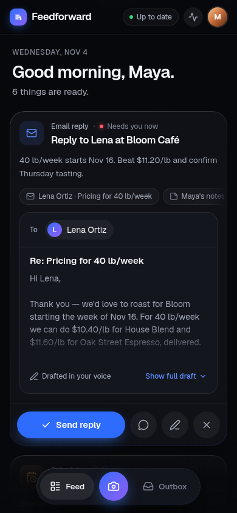
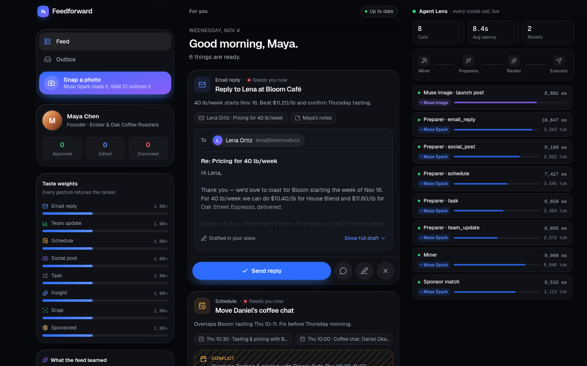

# Feedforward

### Stop prompting. Start scrolling.

**Feedforward turns AI agents into a feed.** Agents built on Muse Spark read your inbox, calendar, sales and notes, do the work in the background, and hand you each result as a card: approve, edit, dismiss, or dive in.

> Meta Global AI Developer Hackathon 2026 · Indie track · *Build for Your World*

<!-- VIDEO_URL -->
**▶ Demo video (3 min):** _link coming soon_

<p align="center">
  
  &nbsp;&nbsp;
  
</p>

---

## Why a feed?

Chat asks people to do work themselves: figure out what the AI can do, explain the task, paste the context, then do it again next time. Most people never get past the empty text box. But billions of people already know how to use a feed: scroll, spot something useful, tap.

Feedforward brings agents into that feed. You don't type a prompt. The agents look at your world, pick the next useful actions, do the work, and line it up for you. Meta invented the feed, and a feed can carry ads, so the business model comes built in: **sponsored actions** matched to your plans this week.

## What it does

The demo persona is **Maya Chen**, founder of *Ember & Oak Coffee Roasters*, a small specialty roastery in Portland. She's launching a new single origin on Friday. **Maya, her company, her customers, suppliers, investors and every sponsor brand are fictional**, and so is the sandbox data (15 emails, a week of calendar, 14 days of sales, launch notes).

### Card kinds

| Card | What the agent already did |
|---|---|
| **Email reply** | Drafted the answer in Maya's voice (e.g. wholesale pricing for a café, a refund for a stale order) |
| **Team update** | Pulled yesterday's sales, computed the metrics and sparkline, wrote the post for the team channel |
| **Schedule** | Found a calendar clash and picked a free slot (checked in code, with a travel buffer), plus the note to the other person |
| **Social post** | Wrote the launch caption and hashtags; **Muse Image** renders the visual |
| **Task / Insight** | Broke a decision into steps, or turned a pattern in the numbers into one headline stat |
| **Snap** | A photo turned into a card: **SAM 3.1** outlines what's in it, Spark reads the line items |
| **Sponsored** | A clearly labeled offer from a fictional sponsor that fits her plans, with *"Why am I seeing this?"* |

### Four gestures

- **Approve** (swipe right): the agent runs the action through a sandboxed tool (`send_email`, `post_message`, `create_event`, `publish_post`, `create_task`, `log_expense`, `open_offer`) and a receipt lands in the **Outbox**.
- **Edit**: a bottom sheet to adjust the prepared payload before approving.
- **Dismiss** (swipe left): the card leaves and the feed retunes.
- **Dive in**: a chat that already has the card, its source documents and Maya's context. One-tap chips (*Make it shorter*, *More formal*) rewrite the draft right on the card.

### It learns while you scroll

Each gesture changes the weight of that card kind (approve +0.15, edit +0.05, dismiss −0.25), the feed re-ranks with an animation, and a toast tells you what changed (*"Tuned: fewer team updates"*). After every 3 gestures, Muse Spark rewrites a short **taste memory** (up to 5 notes such as *"Skips newsletters and promos"*), and the Miner reads it before the next batch, so later batches change visibly. Scroll to the bottom and the next batch loads.

### Snap: the physical world goes in the feed too

Snap a photo (camera on mobile, file on desktop, or one of two demo photos). Muse Spark vision reads it against Maya's context. On the supplier invoice, without being asked, it linked the paper to the supplier's email and to a teammate's low-stock note. SAM 3.1 then outlines each object pixel by pixel, the outlines animate over the photo, and follow-up cards appear (confirm with the supplier, reorder, log the expense).

### Sponsored actions

Every batch includes one sponsored card from a catalog of six invented brands. Muse Spark picks the one that fits Maya's actual week and writes the reason (*"Launching Guji on Friday → rush printed bags"*). Brands rotate between batches. Sponsored cards are labeled, explained, and dismissible, and dismissing them trains the feed like any other card.

## Meta models at the core

All model calls go through the Meta Model API (`https://api.meta.ai/v1`, OpenAI-compatible) via a single wrapper, [`lib/meta.ts`](lib/meta.ts).

| Model | Endpoint | What it does in Feedforward |
|---|---|---|
| **`muse-spark-1.3`** | `/chat/completions`, strict `json_schema`, `reasoning_effort: "low"` | **Signal Miner** (finds 5 action opportunities per batch) · **Preparers** (one per card, in parallel, each with its own payload schema) · **Sponsor matcher** · **Taste memory** · **Revise** (rewrites a payload from a one-line instruction) · **Dive-in chat** (streamed) |
| **`muse-spark-1.3`** (vision) | `/chat/completions` with `image_url` | **Snap vision**: what's in the photo, line items, which objects to outline (as plain visual nouns for SAM), and 2 follow-up actions |
| **`muse-image-1.0`** | `/images/generations` → `b64_json` webp | **Launch post visuals**, rendered in the background while the card is already usable |
| **`sam-3.1`** | `/responses` (Responses API), `input_text` + `input_image`, `mask_encoding: "one_bit"` | **Snap outlines**: one request per noun phrase, in parallel, parsed with [`@meta-sam/parser`](https://www.npmjs.com/package/@meta-sam/parser) into boxes and SVG paths |

We also evaluated **Muse Wonder 1.0** for the Dive-in chat. Its answers were a little sharper, but it was 3–4× slower than Spark (first token after 15–36 s vs 6.6–9.2 s), so Spark runs the chat. The numbers are in [`docs/BUILD_NOTES.md`](docs/BUILD_NOTES.md).

## Architecture

<p align="center"></p>

<details>
<summary>Text version</summary>

```
Browser (Next.js client, zustand + localStorage)
  Feed · Edit sheet · Dive-in chat · Snap · Outbox · Taste panel · Agent Lens
        │  POST, client sends its taste notes + seen titles        ▲ NDJSON event stream
        ▼                                                          │
Next.js route handlers (stateless)
  /api/feed    Miner ─► Preparers ×5 (parallel) ─► Muse Image (background)
               └─ Sponsor match (parallel, slotted after the 3rd card)
  /api/snap    Spark vision ─► SAM 3.1 ×N phrases (parallel) ─► Preparers ×2
  /api/chat    Dive-in chat, streamed text      /api/revise   payload rewrite
  /api/taste   gestures ─► taste notes          /api/act      sandboxed tools ─► receipt
  /api/image   Muse Image retry
        │  lib/meta.ts: openai SDK (baseURL = Meta), 30 s timeout, 1 retry,
        ▼  zod validation, a trace event per call, mock switch
Meta Model API: muse-spark-1.3 · muse-image-1.0 · sam-3.1
```

</details>

## How it works

1. **Scanning starts at once.** `/api/feed` sends five skeleton cards right away (*"Reading your inbox…"*, *"Pulling 14 days of sales…"*), so the feed is never blank while the Miner reads.
2. **Miner.** One Spark call reads the full context, the learned taste notes and the titles already in the feed, and returns 5 opportunities (kind, title, why, source ids, urgency) as strict JSON. The skeletons are renamed to what was found (*"Drafting reply to Lena…"*), and any it didn't need are dropped.
3. **Preparers.** One Spark call per opportunity, all in parallel, each with a zod schema for its kind. Each card streams to the client as soon as it's ready. Facts that must be exact come from code, not from the model: sales metrics and the sparkline are computed from the data, and calendar slots are checked for conflicts and replaced if the model picked a busy one.
4. **Images and sponsor.** Social post cards start Muse Image in the background (`image` or `image_error` events follow). The sponsor match runs alongside the Miner and goes out after the 3rd card.
5. **Ranking on the client.** `score = urgency × weight[kind] × freshness` (freshness halves every 6 h, floor 0.5). Snap cards stay pinned on top, sponsored cards go in slot 4 and then every 6th, and skeletons keep their place so nothing jumps while agents work. Reorders animate with Framer Motion `layout`.
6. **The NDJSON stream.** Each route writes one JSON event per line: `trace`, `skeleton`, `drop`, `card`, `image`, `image_error`, `card_error`, `done`. If one card fails, the feed keeps going: that card shows a retry state.
7. **Agent Lens.** Every model call sends a `trace` event (step, model, latency, tokens, status). On desktop, the Agent Lens panel shows them as a live timeline, so you can watch the Miner, the five Preparers, SAM and Muse Image do their work.
8. **Mock mode.** With `META_MOCK=1`, every model call returns a deterministic fixture after a short delay. SAM fixtures are recorded raw output from real calls, so the outlines in mock mode are real masks. The e2e tests use mock mode, and it also works as a fallback for the demo.

The server is stateless: the client keeps the feed, taste profile and outbox (zustand + `localStorage`) and sends what each request needs. No database.

## Getting started

Requirements: Node 20+, pnpm, a Meta Model API key.

```bash
pnpm install
cp .env.example .env        # set META_API_KEY=...
pnpm dev                    # http://localhost:3100
```

Run without a key, using recorded fixtures:

```bash
META_MOCK=1 pnpm dev
```

Checks:

```bash
pnpm typecheck && pnpm lint
pnpm test                   # Vitest: ranker, taste math, SAM parsing, schema conversion
pnpm e2e                    # Playwright, mock mode: feed, approve → outbox, retune, sponsored, dive in, snap
pnpm smoke                  # live: one real call each to Muse Spark, Muse Image and SAM 3.1
```

The API key is read on the server only and never reaches the browser.

## Project structure

```
app/
  page.tsx                  shell: feed, tabs, taste panel, Agent Lens
  api/feed|snap|chat|revise|taste|act|image/route.ts
components/
  Feed, FeedCard, ActionBar, SkeletonCard, AgentLens, TastePanel,
  ChatSheet, EditSheet, SnapSheet, Outbox, WhyPopover, Toast…
  cards/                    one body per card kind + the payload editor
lib/
  meta.ts                   the only door to the Meta Model API
  schemas.ts                zod schemas: card payloads, Miner output, feed events
  agents/                   miner, preparer, sponsor, taste, snap, chat
  sam.ts                    SAM output → boxes + SVG paths in image pixels
  ranker.ts  taste.ts       pure ranking and taste math (unit tested)
  store.ts                  client state, NDJSON stream reader, gestures
  tools.ts                  sandboxed tools behind Approve
  mocks.ts …                mock-mode fixtures
data/persona/               Maya's fictional inbox, calendar, sales, notes
data/sponsors.json          six invented sponsor brands
public/demo/                demo photos for Snap (invoice, stock shelf)
tests/unit  tests/e2e       Vitest and Playwright
tests/fixtures/             recorded SAM 3.1 outputs
scripts/smoke.ts            live smoke test
```

## Limitations

- **Sandboxed tools.** Approve runs deterministic mock tools that return a receipt. No email is actually sent and no event is actually created. Connecting real services is the next step.
- **Fictional data.** Every person, company, sponsor and number in the persona is invented. The cards are generated live from that data, but it is still a sandbox, not a real business.
- **Latency.** Muse Spark is a reasoning model. Even at `reasoning_effort: "low"`, one call takes 6–14 s, sometimes more. A live batch shows its first card after about 20 s and all cards after about 30 s, and the Muse Image visual arrives later. Skeletons with live labels and the Agent Lens fill that wait, but it's slower than a real feed should be.
- **Streaming.** Dive-in chat streams, but with a reasoning model the text arrives almost all at once after the thinking phase, so the UI shows a typing indicator rather than text appearing word by word.
- **SAM phrasing.** SAM 3.1 finds plain visual categories ("paper", "sack"), not roles ("invoice"). The vision step translates for it, but an unusual object can come back with no outline.
- **Single user, single device.** State lives in the browser. There are no accounts and no sync.

## What's next

- Real connectors: Gmail, Google Calendar, Shopify, WhatsApp Business, with Approve sending for real.
- A faster model for the preparation step, and token streaming for reasoning output, to bring a batch under 5 seconds.
- An on-device taste profile on Meta open-weights models, so preferences stay private.
- Voice: tell the feed what you're up to and it reshuffles.
- Meta AI glasses: look at an invoice, a shelf or a whiteboard and the feed fills itself.
- A sponsor marketplace where offers bid on matching your plans, not your clicks.

## Built with

Next.js 15 (App Router) · React 19 · TypeScript · Tailwind CSS v4 · Framer Motion · zustand · zod · openai SDK (pointed at the Meta Model API) · `@meta-sam/parser` · Vitest · Playwright.
